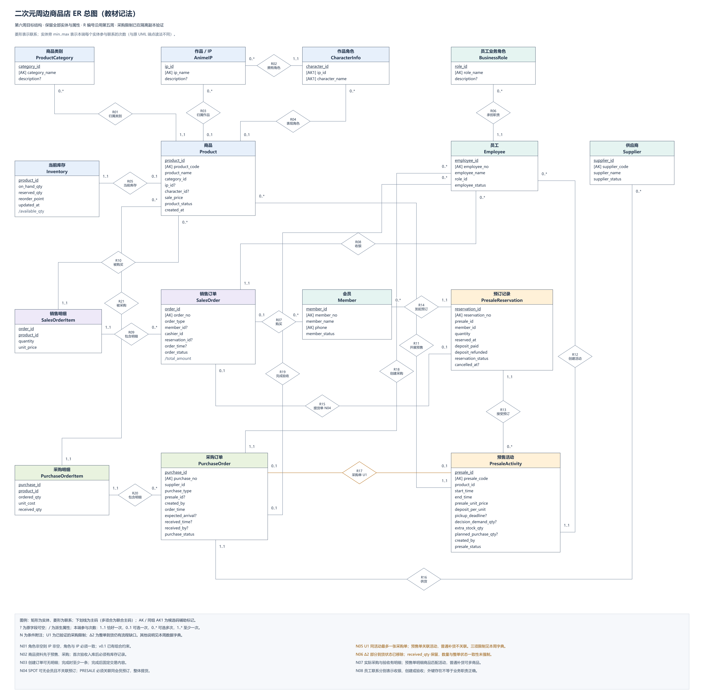

> 历史草稿，保留2026-10-23阶段叙述与当时测试规模。当前正式报告为[第5—9周PDF](../../第二阶段提交/阶段报告.pdf)，本稿仅供追溯。

# 二次元周边商品店数据库应用设计与实现

## 一、实验目标与阶段成果

第二阶段承接第一阶段的单门店数据库，先通过 ER 模型、函数依赖与范式分析检查设计，再将最终关系结构用于可操作的 Web 应用。第5–6周负责解释和调整数据设计，第7–9周负责连接数据库、业务操作、角色权限、事务与集成测试。

项目继续采用单门店线下现货销售为主、会员预售为辅的业务范围。第7–9周实际完成现货经营闭环，预售和采购保留已有表结构与历史查询，完整预售提货、取消退款及采购验收入库留后续扩展。这里选择先完成可复现的商品、库存与销售流程，避免在同一次交付中扩大为完整零售平台。

| 阶段 | 已形成的成果 | 证据性质 |
| --- | --- | --- |
| 第5周 | ER源图及导出图、实体说明、联系规则、v0.1问题清单 | 仓库已有成果 |
| 第6周 | 15表依赖与范式分析、96字段字典、三项采购约束迁移、45项回归结果 | 2026-10-22原Windows实验记录 |
| 第7–9周 | Flask应用、受限SQL账户、四角色操作、事务、40项集成测试及浏览器流程 | 2026-10-23云端独立SQL Server实测 |

本稿汇总第二阶段代码与证据，组员人工审阅、本人环境复跑和最终提交尚需据实完成。完整源码及结果保留在仓库，不将计划内容写成已经运行的结果。

## 二、ER 模型与设计审查

### 2.1 实体与联系

业务模型包含商品类别、作品IP、角色、商品、库存、会员、员工职责、员工、供应商、销售订单及明细、预售活动及预订、采购订单及明细，共15张业务表。商品资料与库存分别保存，销售和采购采用订单头加明细的结构。预售活动连接商品与会员预订，同一商品可以在不同阶段采用现货和预售方式，不固定划分为两类商品。

订单明细采用订单编号与商品编号组成主键，表达同一商品在一张订单中合并为一行的约定。预订单独保存数量、实付订金、状态和取消时间，体现一次预订整体取消或整体提货的业务粒度。会员字段可空，使散客购买不需要虚构会员档案。

第五周审查时区分了业务联系与已有数据库保证。例如销售订单应包含明细，但仅有外键不能保证父表至少存在一条子记录。第7–9周在草稿阶段允许暂时为空，结账时拒绝空明细，既支持页面逐步录入，也保证实际交易完整。

### 2.2 函数依赖、异常与范式

依赖分析检查全部候选码，而不是仅看内部编号。商品编号和业务编号各自决定商品资料，类别名称保存在独立类别表中，避免每件商品重复维护同一类别事实。订单明细中的历史成交价由具体交易决定，不能由商品当前价格直接推出，所以不能用商品现价替代历史单价。

商品表同时保留IP与具体角色。角色非空时，角色决定所属IP，这会产生受条件限制的冗余。单独更改角色归属会影响引用它的多个商品，存在维护代价。由于群像商品允许只填写IP，不能简单删除IP字段。本轮继续保留两字段，由CHECK和复合外键拒绝不一致组合，并明确这一取舍没有消除全部冗余。

预售需求快照、额外备货量和计划采购量也继续保留。需求会在取消后变化，采购决策时的快照仍有解释历史的作用。计划量不要求恒等于需求加额外备货，原业务允许结合现有库存作决策，因此没有增加缺乏业务依据的等式约束。

现有结构没有为了展示规范化而新增拆表。第六周另外使用独立教学关系说明更新异常、无损分解与依赖保持，理论论证与项目样例回归分别记录。样例中没有重复不能证明函数依赖成立。

## 三、迁移与回归

第六周迁移保留15张表、全部96个字段及原数据，仅调整采购订单的三项限制。第一项为非空预售活动关联的过滤唯一索引，同活动最多关联一张采购单，取消单仍占用关联。第二项为采购类型与活动的双向一致性，普通补货必须不关联活动，预售采购必须关联活动。第三项为移除部分到货状态。

收货数量字段继续保留原范围约束，没有增加只能为零或订购量的限制，也没有把整单收齐与状态一致性宣称为已强制实现。库存自动联动仍不属于第六周迁移。

迁移在独立副本上以事务执行，预先检查重复活动、错误类型关联和旧状态，发现冲突时停止，不自动删改历史。成功后再次执行被前提检查拒绝，重演需另取未迁移副本。这个过程与删库重建不同，旧数据作为前后比较的基准保留。

第六周已有记录显示45项回归全部通过，包括逐表全部列比较、订单金额、商品销量、库存、声明式约束和角色权限。订单仍为6笔，金额68、90、129、124、74、45，总额530。商品销量共10件，库存查询保持6行。完整证据见[第六周验证记录](../../第六周业务产出/03_迁移与回归验证记录.md)。

第7–9周从原脚本建立新的专用样例库，再执行同一第六周迁移，以最终结构作为开发基线。没有连接或改变Windows原库，也没有把本次新建样例库描述成对真实经营数据的迁移。

## 四、Web 应用实现与设计选择

### 4.1 技术路线与层次

用户确认采用Flask与SQL Server。页面用Jinja组织HTML，JavaScript通过JSON API提交操作，pymssql负责SQL Server访问。选择这一组合是为了减少前端构建配置，同时能够清楚指出页面层、业务层、数据访问层和数据库层。

页面和路由负责接收输入、调用服务与展示结果。Services检查角色、状态和业务规则，并确定事务范围。Database与Repository集中管理连接、参数绑定、提交、回滚和释放。数据库继续保存表、约束、视图、角色及行级过滤策略。

商品检索从页面进入GET接口，经Services验证身份，最终由Repository执行参数化LIKE查询。所有用户输入通过参数传入，页面层和业务层不拼接SQL。编号生成使用Sequence，避免两个并发请求用MAX加一得到相同主键。序列允许因失败事务留下编号空缺。

### 4.2 认证与职责

新增WebUser技术表保存账户名、密码哈希、角色与员工或会员关联，不改变原Employee和Member的业务含义。密码采用scrypt哈希。每次受保护请求重新检查账户、员工或会员是否有效，收银员从登录员工身份取得，不能由前端改为另一个人。

| 角色 | 可执行流程 |
| --- | --- |
| 管理员 | 商品增改删、库存调整、现货销售和查询 |
| 销售店员 | 查询商品与库存、选择会员或散客、维护草稿和明细、结账 |
| 库存管理员 | 商品库存查询、库存初始化、实际量增减和警戒值调整 |
| 顾客 | 浏览在售商品及可售量，查询本人订单与明细 |

顾客属于线下会员，购买仍由店员收银，不在本轮引入线上商城。这样既符合单门店范围，也满足课程至少区分店员和顾客的要求。

页面按角色隐藏入口，业务方法再次检查权限。各角色还使用不同的受限SQL账户，认证账户仅能读取认证所需资料。顾客订单同时使用会员过滤和SQL Server行级安全策略，即使省略应用查询中的会员条件，数据库仍不返回其他会员订单或明细。

### 4.3 商品、库存与必要删除

管理员新增商品时自动建立零库存记录。指定角色必须有匹配IP，重复业务编号和非法外键由数据库继续保护。商品存在库存或历史引用时拒绝删除，退出经营使用停售表达，避免抹去交易依据。

库存调整采用增减量，数据库带锁读取后计算新实际库存，禁止低于预留量。缺少库存行的商品允许初始化。现货销售不修改预留库存，库存管理员也没有修改预留量的授权。当前版本没有库存流水表，变化结果保存在Inventory，请求定位信息保存在后端日志。

## 五、订单事务与业务流程

### 5.1 草稿与成交历史

订单先以CREATED保存，可以修改会员、增加商品、替换数量或移除明细。草稿不占库存，便于店员逐步录入。空草稿可以保存，结账必须至少有一条明细。

结账时使用当时售价保存成交价，完成后订单与明细只读。商品后续调价不影响已有成交金额。未结账草稿允许取消或删除，取消单保留，已完成订单不通过删除来处理退货，售后业务继续不在当前范围内。

### 5.2 原子结账与并发

一次结账包含锁定订单、核对状态、读取明细、检查在售商品、刷新成交价、扣减库存和完成订单。全部操作使用同一连接、同一事务，成功后统一提交。失败时整单回滚。

库存扣减使用带可售数量条件的UPDATE，并检查影响行数。商品按编号排序加锁，订单锁避免重复完成。这里不能只在页面先查库存，因为查询之后可能被另一个请求消费，判断必须与实际更新一起受事务保护。

多商品失败测试中，第一件商品库存为5，第二件商品只有预留库存，没有可售量。第一件已经执行的扣减与价格刷新因第二件失败一起回滚，结果库存仍为5，草稿单价仍为12.50，订单仍为CREATED且完成时间为空。这个观察同时检查了数量、金额和状态，没有只看错误提示。

## 六、实验结果与安全验证

### 6.1 实测环境

本次云端使用SQL Server2022 Developer，实例版本16.0.4305.5，Python3.12.14，Flask3.1.2，pymssql2.3.11，waitress3.0.2。专用数据库名为AnimeGoodsStoreDB_Week6App。新样例业务时间设置为UTC加8小时，原datetime2历史值没有批量转换。

### 6.2 集成测试

最终40项测试全部通过，结果保存为pytest文本及JUnit XML。覆盖登录退出、非法输入、CSRF、角色差异、参数化检索、商品和库存操作、订单明细、历史价格、整单回滚、顾客行级隔离、数据库权限及连接故障。

| 观察对象 | 实际结果 | 说明 |
| --- | --- | --- |
| 两商品结账 | 3件单价15与2件单价20，总金额85.00，库存分别10到7、8到6 | 多表写入与扣库一起提交 |
| 历史价格 | 商品之后调为99.00，原订单仍为85.00 | 历史成交价独立保存 |
| 并发争用 | 实际库存3，预留1，两订单各买2，分别返回200和409，最终实际库存1 | 只有一个订单消费最后2件可售库存 |
| 数据库权限 | 顾客改库存、店员改价格、库存员读会员、认证账户读订单均为错误229 | 权限检查超出页面隐藏范围 |
| 顾客隔离 | API查他人订单404，顾客SQL连接直查也为空 | 应用与数据库两层都限制本人范围 |
| 数据库断连 | 返回DATABASE_UNAVAILABLE及503，响应不含SQL与连接信息 | 后端日志通过请求编号定位 |
| 删除失败 | 商品因订单外键被拒绝后，原库存行仍存在 | 必要删除也具备事务回滚 |

商品搜索输入包含DROP TABLE片段时，只作为普通搜索内容，返回空结果，随后商品表仍可查询。价格测试包括NaN、Infinity、负数与小数位超限，数量测试包括布尔值、浮点数、零与超限数值，均由统一错误响应拒绝。

### 6.3 浏览器操作与角色差异

Chromium实际执行管理员新增和修改商品，库存员入库10件，店员给会员1建立草稿并结账2件，页面金额50.00，数据库剩余库存8件。顾客1登录后能看到本人订单，不能看到管理和结账入口，直接在浏览器提交商品写请求仍被FORBIDDEN拒绝。

浏览器输出8张截图，零页面脚本错误。390像素宽度下没有页面整体横向溢出。脚本结束后清理自身创建的演示记录，所以截图中的演示编号不作为最终样例库永久数据。

### 6.4 异常与日志

接口统一返回错误码、简明消息、数据和请求编号。错误输入、未登录、无权限、数据不存在、业务冲突、数据库约束、数据库连接失败分别归类。前端只显示消息和编号，详细错误写入后端日志。

日志保留时间、请求标识、操作、角色、错误码与处理结果，不记录密码和请求正文。写请求要求CSRF令牌，会话Cookie启用HttpOnly与SameSite，页面增加CSP等响应头。这些检查服务于本机课程演示，没有据此声称已经完成生产安全认证或压力测试。

## 七、分工与 AI 辅助

根据李维政在本次会话的明确确认，郑立峰负责第5–6周，李维政负责第7–9周。前者交付ER、规范化、迁移与回归材料，后者负责应用、业务事务、权限、测试及操作说明。最终报告审阅、独立演示和提交材料检查由两人共同完成，完成情况需后续据实补充。

Codex辅助恢复任务要求、比较技术路线、编写分层代码、准备独立样例环境并执行测试。用户确认了Flask与SQL Server方案及成员分工。完整建议、选择和验证过程见[应用AI记录](../../第7-9周业务产出/ai_log.md)，第五、六周保留各自的AI记录。自动测试通过不代替组员本人阅读代码和在个人环境复跑。

## 八、实验总结

本阶段的主要结果是把原先依靠样例和人工操作维持的现货销售规则落实到业务事务中。草稿可以暂时不完整，完成交易必须同时满足明细、价格、状态和库存要求。只检查某张表写入成功不能说明业务已经成功，需要比较多表最终状态，并通过失败场景确认回滚范围。

ER与范式分析解释了哪些事实应独立保存，历史成交价和采购快照则说明并非所有重复都应删除。应用开发继续遵循这个区分，当前价格用于新的结账，旧交易保留历史值。数据库约束保护基础关系，业务层负责操作顺序，受限账户与行级安全策略进一步限制访问范围。

现货核心任务已形成代码、脚本、运行证据、截图和手册。完整预售采购流程、账号管理、库存流水、分页和公网部署仍未实现。最终提交前需要两名组员各自启动并演示，核对报告与本人实际操作一致。

## 材料索引

- [第五周成果](../../第五周业务产出/README.md)，[第六周成果](../../第六周业务产出/README.md)。
- [迁移脚本](../../第六周业务产出/migration.sql)，[数据库回归](../../第六周业务产出/regression.sql)。
- [应用运行说明](../../第7-9周业务产出/README.md)，[设计选择](../../docs/设计与决策/第7-9周.md)。
- [应用验证记录](../../第7-9周业务产出/03_测试与验证记录.md)，[操作手册](../../第7-9周业务产出/02_操作手册.md)。
