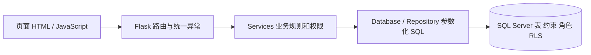

# 分层、身份与事务设计

## 四层对应

页面层包括模板、静态脚本和 Flask 路由。路由接收 JSON 并调用业务方法，不执行 SQL。业务层的每项操作都先核对角色，再判断状态、数值和对象关系，并通过 `Database.transaction` 明确一次操作的事务范围。数据访问层集中绑定参数、执行语句、提交或回滚和关闭连接。SQL Server 的原表约束继续生效，应用额外使用受限账户和行级安全策略。

查询示例为商品搜索，`app.js` 请求 `GET /api/products?q=…`，路由调用 `Services.products`，该方法检查身份后调用 `Repository.products`，SQL Server 执行带 `%s` 参数的 LIKE 查询，结果经固定 JSON 格式返回。搜索内容不会变成 SQL 结构。

修改示例为结账，页面请求 `POST /api/orders/{id}/checkout`，路由调用 `Services.checkout`，业务层建立单个事务，Repository 依次执行锁定、检查、更新，全部成功才提交。任一步异常由数据访问层回滚，HTTP 层统一分类并写日志。

## 身份与角色

`WebUser` 使用 scrypt 密码哈希，账户绑定一个员工或一个会员。员工账户的角色还须与 `BusinessRole` 名称对应，员工或会员停用后，下一次 API 请求重新验证会话身份。浏览器不能提交角色或收银员来替换登录身份。Cookie 内只保存签名后的用户编号、日志用角色和 CSRF 令牌，不保存密码。服务端每次根据编号读取实际身份，日志角色不用于授权。

| 角色 | 页面与业务权限 | SQL 账户限制 |
| --- | --- | --- |
| 管理员 | 商品维护、库存调整、现货订单及明细、结账、查询 | 仅相关商品/库存/销售表和字典，无认证表或采购管理授权 |
| 销售店员 | 商品/库存查询、会员选择、现货订单及明细、结账 | 商品只读，允许销售表写入，库存只能改实际数量和更新时间 |
| 库存管理员 | 商品/库存查询、库存初始化和增减调整 | 无会员和销售订单读取权，无商品价格修改权，无预留量修改权 |
| 顾客 | 在售商品、库存余量、本人订单与明细 | 只读，销售表叠加 RLS，不能扣库存或创建销售记录 |
| 认证服务 | 登录验证、员工/会员有效性检查 | 只读 WebUser、Employee、BusinessRole、Member，无销售和库存权限 |

顾客对应线下会员，购买由销售店员代为收银，顾客没有线上购物车或在线支付。`customer1` 绑定会员 1，`customer2` 绑定会员 2。业务查询按会员过滤，数据库通过 `USER_NAME()='course_customer'`、只读 `SESSION_CONTEXT(member_id)` 及两条 RLS 谓词再次限制订单和明细。每次新连接设置上下文后关闭，不在用户之间复用数据库连接。

受限数据库角色保护表和列的访问范围，草稿状态、商品上架、库存计算仍由业务层控制。持有数据库管理角色的人仍能绕过 Web 改表，本实现不声称受限账户等同于全部业务状态机已在数据库强制。应用凭据仅留服务端配置。

## 状态与价格

`CREATED` 草稿可修改会员及明细，也可删除。首次添加商品时，以目录标价保存明细单价，后端校验页面显示价格与当前标价一致。若页面价格已经过期，拒绝本次登记并提示刷新核对，不自动换价。已有商品再次添加只替换数量，修改数量、查询、刷新和结账均保留登记单价。移除后重新添加视为新登记，采用重新核对后的当前标价。草稿不占库存，结账沿用明细价格计算成交金额。

`COMPLETED` 订单及明细只读，不能重复结账、改会员或删除。`CANCELLED` 订单保留，不能恢复为草稿。本轮仅允许 `SPOT` 草稿进入这些修改接口，历史预售订单可查询，不能借现货接口修改。停售替代有历史商品的删除。零库存且没有外键引用的商品可删除，Inventory 随同在一个事务内删除，外键拒绝时库存删除也回滚。

## 事务与并发

结账先以 `UPDLOCK,HOLDLOCK` 锁定订单，拒绝空明细和非法状态，再按 `product_id` 排序处理商品。锁定商品行，使调价、停售、库存调整和结账遵守相同的商品锁顺序。库存更新同时包含 `on_hand_qty-reserved_qty >= quantity` 条件，以影响行数判断能否完成。成功后订单状态和完成时间在同一事务提交。

第二件商品库存不足时，第一件商品已经执行的扣减和全部状态变化一起回滚，登记单价保持不变。预留数量不受现货销售改变。并发订单争抢最后可售数量时，锁和条件更新共同防止两个订单都消费同一份库存。编号用 Sequence 生成，不采用 MAX+1。失败事务允许消耗序列编号，不要求编号连续。

库存调整接收增减量，读取带锁库存后计算新实际数量，禁止低于预留量和超出整数范围。不存在库存行时先建立零库存。手动盘点仅改实际量和警戒值，不允许直接清除预留量。

## 接口

| 方法与路径 | 输入与作用 | 角色 |
| --- | --- | --- |
| GET /api/session | 当前身份和 CSRF 令牌 | 未登录也可访问 |
| POST /api/login，POST /api/logout | 用户名/密码登录，退出会话 | 登录接口公开，退出须已登录 |
| GET /api/lookups | 类别、IP、角色，销售角色额外得到会员选项 | 已登录 |
| GET /api/products?q= | 检索商品及库存，最多200条 | 已登录，顾客只看在售 |
| POST /api/products | 编号、名称、类别、IP/角色、价格、状态，自动零库存 | 管理员 |
| PUT，DELETE /api/products/{id} | 修改或必要删除 | 管理员 |
| POST /api/inventory/{id}/adjust | delta、reorder_point | 管理员、库存管理员 |
| GET，POST /api/orders | 最近200笔订单，或以 member_id 建草稿 | 查询含顾客，写入限销售角色 |
| GET，PATCH，DELETE /api/orders/{id} | 详情、修改会员、删除草稿 | 查询含顾客，写入限销售角色 |
| PUT，DELETE /api/orders/{id}/items/{product_id} | quantity，新登记还须 expected_unit_price，替换数量或删除明细 | 销售角色 |
| POST /api/orders/{id}/checkout，cancel | 完成结账或取消草稿 | 销售角色 |

写请求都要求 `X-CSRF-Token`，从 `/api/session` 获取。统一响应为 `code`、`message`、`data`、`request_id`。金额用字符串保持两位小数语义，JSON 不让浮点数取代数据库金额。时间显示原数据库本地时间，新样例设置 UTC+8。

错误分类包括 `INVALID_INPUT` 400，`AUTH_REQUIRED`、`AUTH_FAILED` 401，`FORBIDDEN`、`CSRF_FAILED` 403，`NOT_FOUND` 404，`BUSINESS_RULE`、`INSUFFICIENT_STOCK`、`PRICE_CHANGED`、`CONSTRAINT_CONFLICT`、`TRANSACTION_FAILED` 409，`DATABASE_UNAVAILABLE` 503，以及内部错误 500。驱动错误不原样返回，日志不记录请求正文、密码和连接串。

界面按角色与任务区分。店长的商品管理维护资料、售价和上架状态，库存管理独立展示及调整数量。店员仅保留商品目录和销售订单，在目录查看可售量。库存管理员仅使用库存管理，登录和刷新默认进入该页。顾客只看在售商品与我的订单，目录不展示经营指标。订单页概览使用订单数量与状态，不再复用商品库存统计。

商品与库存页分别保存搜索条件。订单选择商品独立读取完整目录，不受商品页筛选影响。退出时清除页面数据与弹窗，异步列表响应校验账户和当前页面，避免切换角色后显示上一视图。接口和数据库权限规则保持原有边界。

点击销售订单页的刷新，会重新读取订单列表、已打开的订单明细，以及店员可选商品的最新价格和库存。顾客只刷新订单及当前明细。刷新只执行查询，不改写草稿单价，也不重新打开已收起的明细。异步详情响应同时检查账户、页面和请求顺序，避免旧请求覆盖当前视图。
