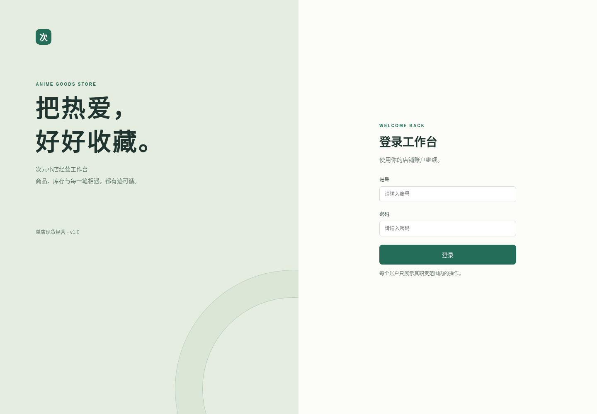
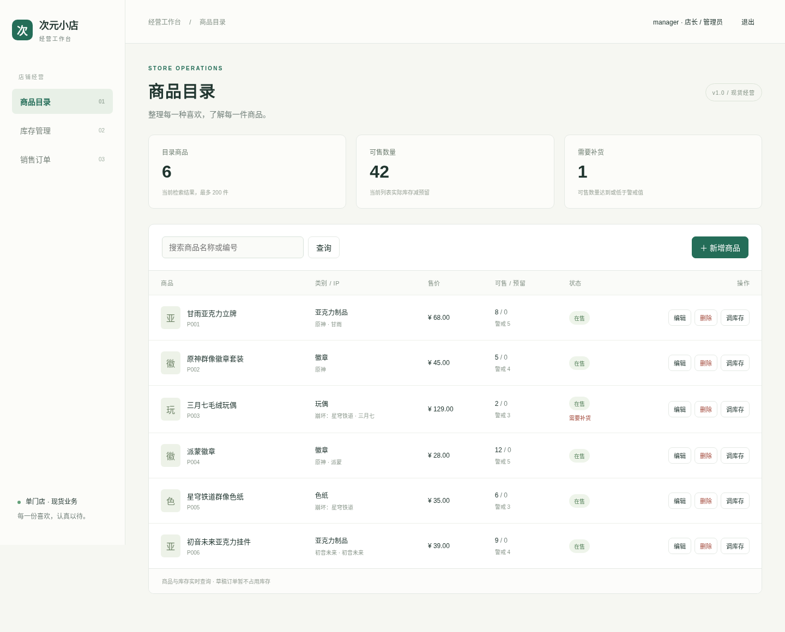
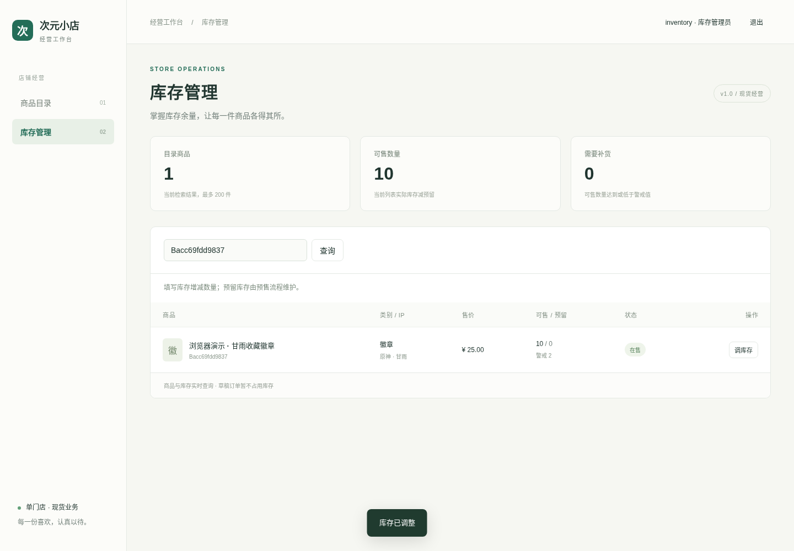
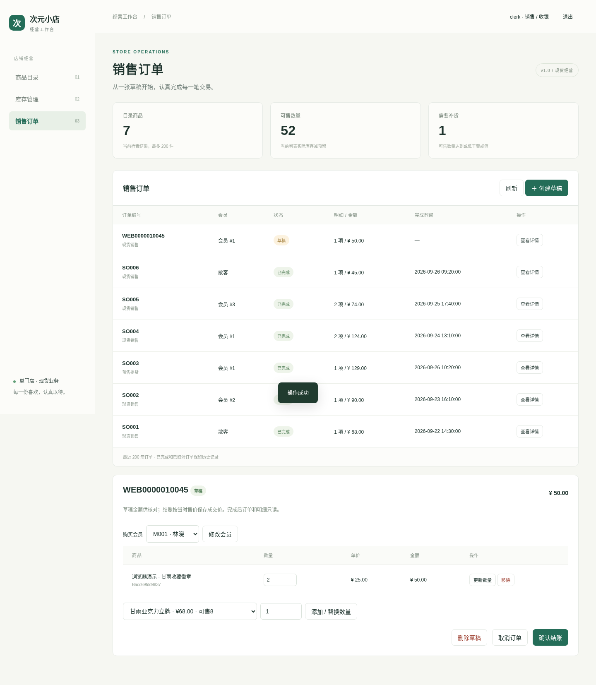
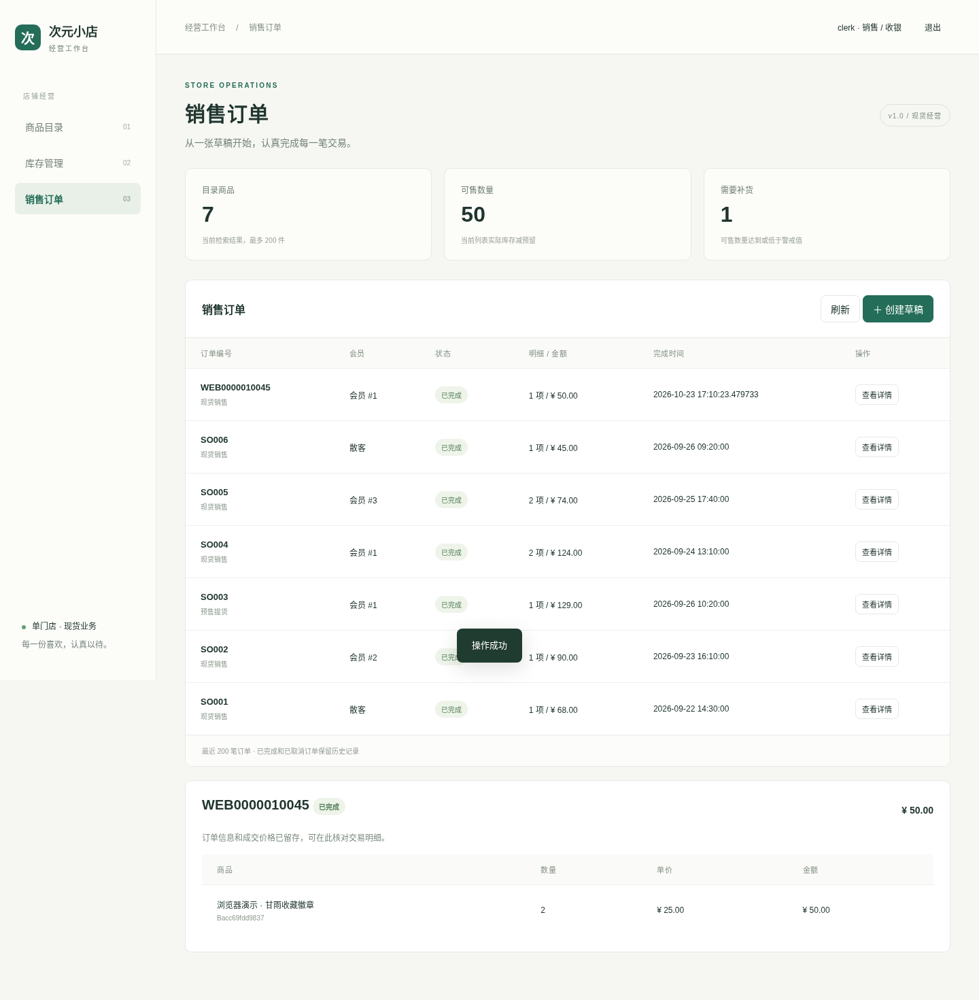
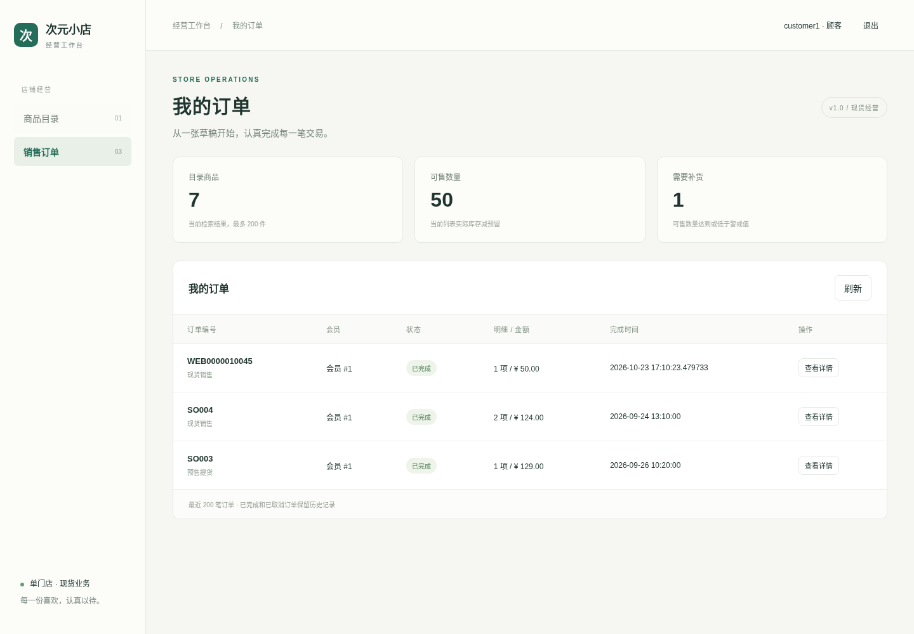

# 工作台操作手册

## 登录与账户

按 README 初始化并启动后，在运行应用的机器打开 `http://127.0.0.1:5000`。用户名使用 `manager`、`clerk`、`inventory`、`customer1` 或 `customer2`，密码为初始化时设置的 `COURSE_DEMO_PASSWORD`。网页不提供自行选择角色的入口，角色与账户绑定。

| 网页账号 | 角色 |
| --- | --- |
| manager | 店长/管理员 |
| clerk | 销售/收银店员 |
| inventory | 库存管理员 |
| customer1、customer2 | 会员1、会员2对应顾客 |

网页密码与 SQL Server 登录口令是两套东西，不要把 sa 的密码填进网页。已有数据库修改环境变量 `COURSE_DEMO_PASSWORD` 不会自动重设 WebUser 中的密码，只有首次初始化时才会读取该变量。

若已能启动网页但忘记密码，在应用目录的 Python 虚拟环境执行下列命令，输入两次自己选择的至少12位密码。

```powershell
python scripts/reset_web_password.py --username manager
```

脚本生成 `reset_web_password.local.sql`，此时尚未修改数据库。在 SSMS 连接与网页配置相同的 SQL Server 实例，选择 `AnimeGoodsStoreDB_Week6App`，打开并执行该文件。成功后使用 `manager` 和新密码登录。该操作只更新指定有效网页账户的密码哈希，不重建数据库，也不修改商品、订单、库存或 SQL 登录。其他角色换成对应账号重设即可。若提示缺少 WebUser，说明该库尚未完成应用初始化或实例选错，应先核对配置。

如果网页显示“系统暂时无法完成操作”，应先检查后端数据库连接和日志，而不是直接判断密码错误。只有“账号或密码不正确，或账号已停用”才属于认证未通过的提示。



## 管理员维护商品

登录 `manager` 后进入商品目录，使用名称或编号检索。点击新增商品，填写编号、名称、类别、售价及状态。IP 和角色可以留空，指定角色时须填写匹配的 IP。保存后自动建立零库存记录。

点击编辑可以改名称、价格、类别和销售状态。已成交订单保存的历史单价不随商品调价变化。若商品不再经营，可改为停售。只有零库存且没有销售、预售、采购等历史引用的商品才能删除，删除失败不会丢失库存记录。



## 库存管理员调整库存

登录 `inventory`，进入库存管理，搜索商品并点击调库存。入库填写正数，盘亏填写负数，零表示只调整警戒值。调整后实际库存不能低于预留库存。表格同时展示可售量、预留量和补货警戒值。

预留量由预售业务维护，本界面只允许修改实际库存和警戒值。当前版本没有单独库存流水表，操作请求保留在后端日志，数量变更结果直接保存至 Inventory。不要在网络迟缓时重复点击确认，重复成功请求会再次增减。



## 销售店员完成现货销售

1. 登录 `clerk`，进入销售订单并创建草稿。可选会员，非会员选择散客。经办员工由登录身份确定。
2. 在草稿详情选择商品并填写数量，点击添加或替换数量。同一商品再次添加会替换原数量。已有明细可以更新数量或移除，草稿会员也可以修改。
3. 核对商品、数量及金额。草稿不占库存，草稿金额按加入或更新时售价暂存。点击确认结账后，系统按当时售价保存成交价并检查可售库存。
4. 成功时订单变为已完成，并一次性扣减库存。失败时保持草稿，全部商品库存和本次价格变动一起回滚，按提示调整数量后重试。
5. 未结账草稿可以取消或删除。取消后保留记录，已完成和已取消订单都不可再改或删除。





管理员也可执行上述销售操作。历史预售提货订单能够查询，其状态不能通过现货草稿接口修改。

## 顾客查询

`customer1` 对应会员 1，`customer2` 对应会员 2。登录后可以浏览在售商品和余量，进入我的订单查看本人的交易及明细。顾客没有商品维护、库存调整、创建草稿或结账按钮，直接提交这些接口也会被拒绝。到店购买由销售店员完成收银。



## 本机复现与实验截图

SSMS 是管理客户端，数据库服务是 SQL Server，网页程序是 Flask。使用原生本机 SQL Server 时不需要另启 Docker，浏览器与 SSMS 应访问同一实例、同一应用库。只安装 SSMS 而没有可连接的数据库引擎，无法提供应用的数据存储。

课程要求可运行、可复现并展示角色流程，没有要求必须使用本机原生实例。已有云端截图来自自动实测，可作为历史证据，但不能写成组员本机操作结果。建议本人在本机完整复跑一次，保存本人实际操作的页面与数据库结果。

1. 在 SSMS 确认应用库及 WebUser、商品、库存、订单表存在。
2. 管理员登录，新增或修改商品，截图页面反馈。
3. 库存管理员调整演示商品库存，截图前后数量。
4. 店员建立含两种商品的草稿并结账，截图订单和明细金额。
5. 在 SSMS 查询同一订单与商品库存，核对写入及扣减。
6. 顾客登录，只查询本人订单，展示与店员不同的操作入口。
7. 保存库存不足等失败提示，并核对未完成订单和库存未变化。

第7–9周不需要把全部操作都改成在 SSMS 手动写 SQL，关键是通过网页操作，再用数据库结果核对。复跑后将实际截图和环境信息补入报告，既有第5–6周结果保留原阶段日期与来源。

## 错误处理

账号或密码错误时重新核对。页面过期时刷新并重新登录。库存不足时调整草稿数量，商品已停售时更换明细。编号重复、外键冲突或商品有历史引用时，检查资料或改用停售。系统暂不可用时稍后重试，并把提示中的请求编号交给维护人员核对日志，不需要复制密码或连接信息。

页面上方统计值来自当前检索列表，最多 200 件商品，并非大规模门店的全量经营报表。订单列表展示最近 200 笔。课程样例规模内可以直接操作，更大数据量需要增加分页。
